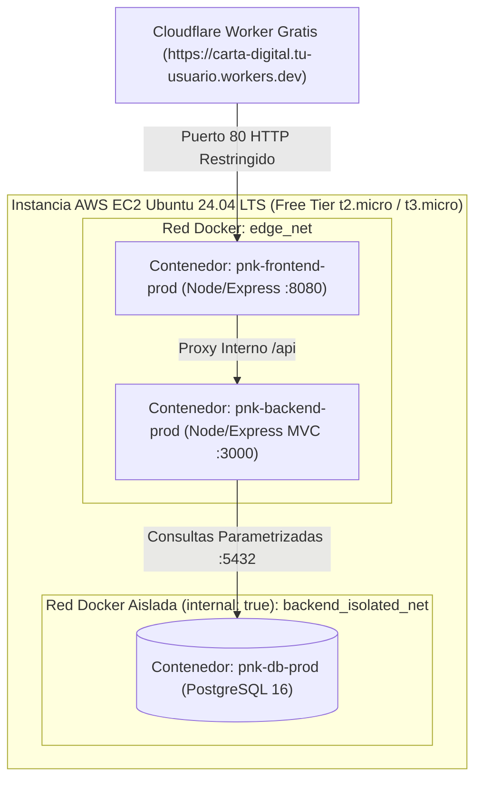

# Guía Paso a Paso: Despliegue en AWS EC2 (Ubuntu + Docker) en Capa Gratuita
## Proyecto: Carta Digital PNK Security — Estándar OWASP ASVS v5.0 (Nivel 3)

Esta guía explica paso a paso cómo crear, asegurar y desplegar el proyecto completo (**Front-End + Back-End MVC en Node.js/Express + PostgreSQL 16**) dentro de una instancia **AWS EC2 con Ubuntu Server** en la **Capa Gratuita de AWS (Free Tier)**, recibiendo el tráfico desde tu subdominio fijo gratuito de Cloudflare (**`https://carta-digital.<tu-usuario>.workers.dev`**).

---

## Arquitectura Interna en AWS EC2 con Docker (`docker-compose.prod.yml`)



---

## Paso 1: Crear la Instancia EC2 en AWS (Capa Gratuita / Free Tier)

1. Inicia sesión en la [Consola de AWS](https://console.aws.amazon.com/ec2/) y ve a **EC2 > Instances > Launch an instance**.
2. **Name:** `pnk-carta-digital-prod`
3. **Application and OS Images (AMI):**
   - Selecciona **Ubuntu** -> **Ubuntu Server 24.04 LTS (HVM), SSD Volume Type** (verifica que diga **Free tier eligible**).
   - Arquitectura: `64-bit (x86)`.
4. **Instance type:**
   - Selecciona **`t2.micro`** o **`t3.micro`** (1 vCPU, 1 GiB RAM — **Free tier eligible**: 750 horas/mes gratuitas).
5. **Key pair (login):**
   - Haz clic en **Create new key pair**:
     - **Key pair name:** `pnk-ec2-deploy-key`
     - **Key pair type:** `ED25519` (o `RSA`)
     - **Private key file format:** `.pem`
   - Descarga el archivo `pnk-ec2-deploy-key.pem`.
6. **Network settings (Security Group — Reglas de Firewall ASVS v5.0 V14):**
   - Haz clic en **Edit** y crea el grupo de seguridad `pnk-asvs5-sg` con solo 2 reglas de entrada:
     - **SSH (Puerto 22 / TCP):** `0.0.0.0/0` (autenticado exclusivamente con tu llave criptográfica `.pem`).
     - **HTTP (Puerto 80 / TCP):** `0.0.0.0/0` (para que el Worker de Cloudflare `*.workers.dev` pueda conectarse al contenedor Front-End).
     - **Importante:** **NO** abras el puerto `3000` (Backend) ni el puerto `5432` (PostgreSQL). Ambos corren aislados dentro de la red interna de Docker.
7. **Configure storage:**
   - `1x 20 GiB gp3` (La capa gratuita de AWS incluye hasta **30 GB de almacenamiento EBS** gratis).
8. Haz clic en **Launch instance** y anota la **Public IPv4 address** asignada a tu instancia.

---

## Paso 2: Conectarse por SSH y Preparar Memoria Swap (Crítico en Free Tier de 1 GB RAM)

Las instancias gratuitas (`t2.micro` / `t3.micro`) tienen 1 GB de RAM. Configurar 2 GB de memoria Swap garantiza que la compilación de imágenes Docker y PostgreSQL funcionen siempre sin quedarse sin memoria:

1. Conéctate a tu instancia desde tu terminal:
   ```bash
   chmod 400 pnk-ec2-deploy-key.pem
   ssh -i pnk-ec2-deploy-key.pem ubuntu@<IP_PUBLICA_EC2>
   ```
2. Actualiza el sistema operativo e instala parches de seguridad:
   ```bash
   sudo apt-get update && sudo apt-get upgrade -y
   sudo apt-get install -y curl git ufw unattended-upgrades ca-certificates gnupg
   ```
3. Crea y activa el archivo Swap de 2 GB:
   ```bash
   sudo fallocate -l 2G /swapfile
   sudo chmod 600 /swapfile
   sudo mkswap /swapfile
   sudo swapon /swapfile
   echo '/swapfile none swap sw 0 0' | sudo tee -a /etc/fstab
   free -h
   ```

---

## Paso 3: Instalar Docker Engine y Docker Compose Oficial en Ubuntu

Ejecuta los siguientes comandos en la instancia EC2 para instalar Docker y agregar al usuario `ubuntu` al grupo `docker`:

```bash
# 1. Agregar llave GPG oficial de Docker
sudo install -m 0755 -d /etc/apt/keyrings
curl -fsSL https://download.docker.com/linux/ubuntu/gpg | sudo gpg --dearmor -o /etc/apt/keyrings/docker.gpg
sudo chmod a+r /etc/apt/keyrings/docker.gpg

# 2. Agregar el repositorio oficial de Docker
echo \
  "deb [arch=$(dpkg --print-architecture) signed-by=/etc/apt/keyrings/docker.gpg] https://download.docker.com/linux/ubuntu \
  $(. /etc/os-release && echo "$VERSION_CODENAME") stable" | \
  sudo tee /etc/apt/sources.list.d/docker.list > /dev/null

# 3. Instalar Docker Engine y Docker Compose
sudo apt-get update
sudo apt-get install -y docker-ce docker-ce-cli containerd.io docker-buildx-plugin docker-compose-plugin

# 4. Permitir al usuario 'ubuntu' ejecutar docker sin sudo
sudo usermod -aG docker ubuntu
newgrp docker

# 5. Verificar instalación
docker --version
docker compose version
```

---

## Paso 4: Clonar el Repositorio y Configurar las Variables de Entorno de Producción (`.env`)

1. Crea el directorio de despliegue `/opt/carta-digital` y asígnalo al usuario `ubuntu`:
   ```bash
   sudo mkdir -p /opt/carta-digital
   sudo chown -R ubuntu:ubuntu /opt/carta-digital
   cd /opt/carta-digital
   ```
2. Clona tu repositorio de GitHub:
   ```bash
   git clone https://github.com/<TU_USUARIO>/<TU_REPOSITORIO>.git .
   git checkout main
   ```
3. Genera secretos criptográficos de alta entropía (256 bits) según **OWASP ASVS v5.0 Nivel 3 (V6.3 y V14.2)** y crea el archivo `.env` indicando tu subdominio gratuito `.workers.dev`:
   ```bash
   DB_PASS=$(openssl rand -hex 32)
   PEPPER_SECRET=$(openssl rand -hex 32)

   cat <<EOF > /opt/carta-digital/.env
   NODE_ENV=production
   POSTGRES_DB=pnk_security
   POSTGRES_USER=pnk_prod_user
   POSTGRES_PASSWORD=${DB_PASS}
   PASSWORD_PEPPER=${PEPPER_SECRET}
   CORS_ORIGIN=https://carta-digital.<tu-subdominio>.workers.dev
   ENFORCE_HTTPS=1
   EOF

   # Restringir permisos de lectura del archivo .env exclusivamente al propietario (ASVS v5.0 V14)
   chmod 600 /opt/carta-digital/.env
   ```

---

## Paso 5: Levantar el Ambiente de Producción con Docker Compose

1. Construye e inicia los 3 contenedores endurecidos de Producción (`pnk-db-prod`, `pnk-backend-prod` y `pnk-frontend-prod`):
   ```bash
   cd /opt/carta-digital
   docker compose -f docker-compose.prod.yml up -d --build
   ```
2. Verifica que los 3 contenedores estén en estado `Up (healthy)`:
   ```bash
   docker compose -f docker-compose.prod.yml ps
   ```
3. Prueba localmente el endpoint de salud:
   ```bash
   curl -i http://127.0.0.1/health
   curl -i http://127.0.0.1/api/health
   ```

---

## Paso 6: Configurar los Secretos en GitHub Actions para Despliegue Continuo

En tu repositorio de GitHub, ve a **Settings > Secrets and variables > Actions** y registra estos 5 secretos:

| Nombre del Secreto | Valor |
| :--- | :--- |
| `AWS_EC2_HOST` | La IP pública de tu instancia AWS EC2 (ej. `54.233.10.25`) |
| `AWS_EC2_USER` | `ubuntu` |
| `AWS_EC2_SSH_KEY` | El contenido completo de tu archivo `pnk-ec2-deploy-key.pem` |
| `CLOUDFLARE_ACCOUNT_ID` | Tu Account ID de Cloudflare (para actualizar el Worker `.workers.dev`) |
| `CLOUDFLARE_API_TOKEN` | Tu API Token de Cloudflare con plantilla *Edit Cloudflare Workers* |

Con esto, después de cada commit a `main`, el flujo **Git -> QA con IA (GitHub Copilot Models) -> Cloudflare (`*.workers.dev`) -> AWS EC2 (Docker)** se ejecutará de extremo a extremo de forma 100% automática y gratuita.
