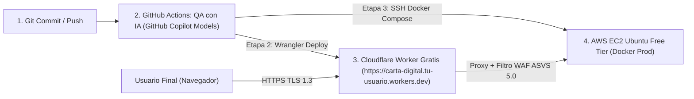

# Guía Paso a Paso: Despliegue en Cloudflare con Subdominio Fijo Gratuito (`*.workers.dev`)
## Proyecto: Carta Digital PNK Security — Estándar OWASP ASVS v5.0 (Nivel 3)

Esta guía explica paso a paso cómo usar **exclusivamente la Opción 2 (Subdominio fijo gratuito `https://carta-digital.<tu-usuario>.workers.dev` de Cloudflare Workers)** sin comprar dominio ni ingresar tarjeta de crédito, conectándolo entre **GitHub Actions** y tu servidor **AWS EC2 (Ubuntu + Docker)**.

---

## Arquitectura del Flujo de Publicación (`Git -> QA IA -> Cloudflare *.workers.dev -> AWS EC2`)



---

## Paso 1: Crear tu Cuenta Gratuita en Cloudflare y Elegir tu Subdominio `.workers.dev`

1. Entra a [https://dash.cloudflare.com/sign-up](https://dash.cloudflare.com/sign-up) y regístrate gratis con tu correo electrónico.
2. **No agregues ningún dominio.** En el menú lateral izquierdo haz clic directamente en **Workers & Pages**.
3. Haz clic en el botón azul **Create** (Crear) y luego en **Create Worker**.
4. Cloudflare te pedirá elegir por única vez tu subdominio gratuito (por ejemplo: `pnk-inacap.workers.dev`).
5. En el campo **Name** escribe exactamente:
   ```text
   carta-digital
   ```
6. Haz clic en **Deploy**.
   - ¡Listo! Tu dirección web pública, fija y gratuita con certificado HTTPS oficial de Cloudflare será para siempre:
     `https://carta-digital.<tu-subdominio>.workers.dev`

---

## Paso 2: Cargar el Código del Proxy/WAF o Conectarlo con GitHub Actions

Tienes dos formas de mantener actualizado el Worker (puedes hacer la manual la primera vez y dejar la automática para cada commit):

### A. Configuración Manual en el Panel de Cloudflare (1 minuto)
1. Dentro de tu Worker `carta-digital`, haz clic arriba a la derecha en **Edit code**.
2. Borra todo el texto de ejemplo y pega el contenido íntegro del archivo [`cloudflare-worker/worker.js`](./cloudflare-worker/worker.js) de este repositorio.
3. Haz clic en **Deploy** (arriba a la derecha) y regresa al panel del Worker.
4. Ve a la pestaña **Settings > Variables and Secrets** -> haz clic en **Add**:
   - **Type:** `Text`
   - **Variable name:** `EC2_ORIGIN_URL`
   - **Value:** `http://<IP_PUBLICA_DE_TU_AWS_EC2>` *(ejemplo: `http://54.233.10.25`)*
5. Haz clic en **Deploy**.

### B. Actualización Automática tras cada Commit desde GitHub Actions
El archivo [`.github/workflows/ci-cd-pipeline.yml`](./.github/workflows/ci-cd-pipeline.yml) ya incluye el job `deploy_cloudflare_worker` que actualiza automáticamente tu Worker después de cada commit aprobado por el QA de IA. Para activarlo:

1. **Copia tu `Account ID` de Cloudflare:**
   - En el menú lateral de Cloudflare ve a **Workers & Pages > Overview**.
   - En la barra derecha, bajo **Account details**, copia el **Account ID**.
2. **Crea tu `API Token` de Cloudflare Workers:**
   - En esa misma barra derecha, haz clic en **Create API Token**.
   - Haz clic en **Use template** junto a la plantilla **"Edit Cloudflare Workers"**.
   - En **Account Resources** selecciona `Include` -> `<Tu Cuenta>`.
   - Haz clic en **Continue to summary** -> **Create Token** y copia el token.
3. **Agrega los 2 secretos en GitHub:**
   - En tu repositorio de GitHub ve a **Settings > Secrets and variables > Actions > New repository secret** y crea:
     - `CLOUDFLARE_ACCOUNT_ID`: Tu Account ID de Cloudflare.
     - `CLOUDFLARE_API_TOKEN`: El token que acabas de crear.

---

## Paso 3: Qué hace exactamente `cloudflare-worker/worker.js` por tu Seguridad (ASVS v5.0 Nivel 3)

Cada vez que un usuario entra a `https://carta-digital.<tu-subdominio>.workers.dev/carta`:
1. **Cifrado HTTPS (TLS 1.3):** El navegador del usuario se conecta de forma cifrada al borde de Cloudflare sin mostrar advertencias de certificado.
2. **Ocultación de la IP de AWS EC2 y URL Ofuscada (Sin `?id=` ni `?keyid=`):** El usuario nunca ve la dirección IP de tu servidor EC2 ni identificadores de base de datos en la barra de direcciones (`/carta` y `/carrito`).
3. **Filtro WAF en el Borde (ASVS V14):** Bloquea instantáneamente con `HTTP 403` cualquier intento de escanear archivos sensibles (`/.env`, `/.git`, `/wp-admin`, `/phpmyadmin`) antes de que la petición llegue a tu EC2.
4. **Inyección de Cabeceras ASVS v5.0 Nivel 3:** Fuerza en el borde `Strict-Transport-Security: max-age=31536000; includeSubDomains; preload`, `X-Frame-Options: DENY`, `X-Content-Type-Options: nosniff` y `Referrer-Policy: strict-origin-when-cross-origin`.

---

## Paso 4: Verificación Final

Una vez que tu instancia AWS EC2 esté corriendo (ver [`DESPLIEGUE_AWS_EC2.md`](./DESPLIEGUE_AWS_EC2.md)), abre en tu navegador la ruta limpia sin IDs:

```text
https://carta-digital.<tu-subdominio>.workers.dev/carta
```

Y para comprobar las cabeceras de seguridad desde terminal:
```bash
curl -I "https://carta-digital.<tu-subdominio>.workers.dev/carta"
```
