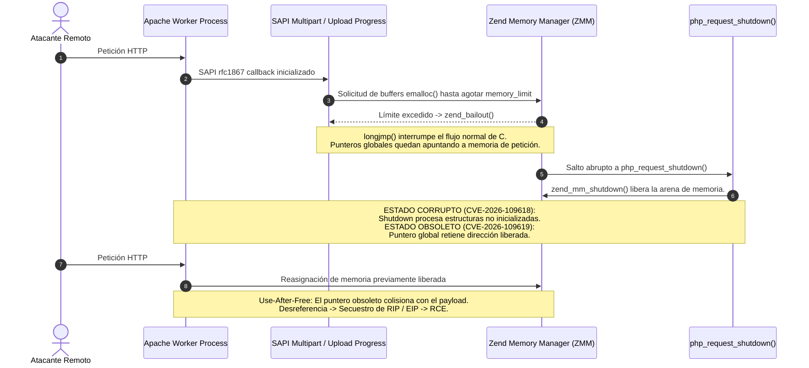
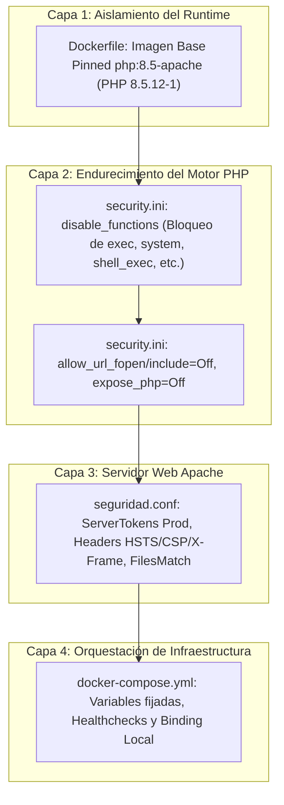

# INFORME TÉCNICO DE SEGURIDAD Y ANÁLISIS DE VULNERABILIDADES
## VUL-20: Ejecución Remota de Código en PHP Engine (PHP2Shell: CVE-2026-109618 y CVE-2026-109619)

**Proyecto:** PNK Security — Plataforma Web Segura  
**Clasificación:** Confidencial / Auditoría de Seguridad & Gestión de Vulnerabilidades  
**Fecha de Publicación:** 26 de Octubre de 2026  
**Investigador / Auditor:** Especialista en Investigación de Vulnerabilidades y Análisis de Exploits  
**Rama:** `PHP-8.5`  
**Estado:** Vulnerabilidad Mitigada y Verificada (Parche Upstream + Endurecimiento Defense-in-Depth)

---

## 1. Resumen Ejecutivo y Ficha Técnica de las Vulnerabilidades

### 1.1 Resumen Ejecutivo
En octubre de 2026 se identificó y divulgó una cadena crítica de vulnerabilidades en el núcleo (*core engine*) del lenguaje PHP, denominada colectivamente por la comunidad de ciberseguridad como **"PHP2Shell"**. La amenaza comprende dos identificadores principales de vulnerabilidades y exposiciones comunes: **CVE-2026-109618** y **CVE-2026-109619**.

Estas fallas afectan directamente la gestión de memoria interna del motor Zend (Zend Memory Manager - ZMM) y el ciclo de vida de los procesos trabajadores (*workers*) de servidores web en entornos multi-petición (tales como Apache `mod_php` y `php-fpm`). Un atacante remoto no autenticado puede enviar secuencias de peticiones HTTP multipart especialmente manipuladas para provocar un agotamiento de memoria (*Out-Of-Memory* - OOM) no controlado durante la fase previa a la ejecución de scripts (por ejemplo, a través del mecanismo nativo `session.upload_progress`). 

Dicho desbordamiento induce una corrupción de estructuras internas y un estado colgante (*stale pointer*) reutilizable entre peticiones sucesivas del mismo proceso worker (*Use-After-Free* cross-request), habilitando la **Ejecución Remota de Código (RCE)** con los privilegios del proceso del servidor web (`www-data`).

En respuesta inmediata a esta amenaza, el proyecto PNK Security implementó una actualización estructural de la imagen base hacia la versión corregida **PHP 8.5.12** (paquete Debian `8.5.12-1`), combinada con un esquema de endurecimiento multicapa (*Defense-in-Depth*) a nivel de runtime PHP (`security.ini`), servidor web Apache (`seguridad.conf`) y orquestación de contenedores (`docker-compose.yml`).

---

### 1.2 Ficha Técnica Consolidada

| Parámetro | Detalle Técnico |
| :--- | :--- |
| **Identificadores CVE** | **CVE-2026-109618** & **CVE-2026-109619** |
| **Nombre Colectivo** | **PHP2Shell** |
| **Puntuación Base CVSS v3.1** | **9.8 (Severidad Crítica)** |
| **Vector CVSS v3.1** | `CVSS:3.1/AV:N/AC:L/PR:N/UI:N/S:U/C:H/I:H/A:H` |
| **Puntuación Base CVSS v4.0** | **9.3 (Severidad Crítica)** (`CVSS:4.0/AV:N/AC:L/AT:N/PR:N/UI:N/VC:H/VI:H/VA:H/SC:N/SI:N/SA:N`) |
| **Tipo de Explotación** | Remota, No Autenticada, Pre-script Execution |
| **Impacto Primario** | Control Total del Sistema Operativo Subyacente (RCE / Remote Code Execution) |
| **Clasificación CWE** | • **CWE-94:** Improper Control of Generation of Code ('Code Injection')<br>• **CWE-78:** Improper Neutralization of Special Elements used in an OS Command ('OS Command Injection')<br>• **CWE-416:** Use-After-Free (UAF)<br>• **CWE-119:** Improper Restriction of Operations within the Bounds of a Memory Buffer ('Memory Corruption')<br>• **CWE-400:** Uncontrolled Resource Consumption (OOM Condition)<br>• **CWE-457:** Use of Uninitialized Variable |
| **Alcance de Versiones Afectadas** | • **PHP 8.5:** 8.5.0 a 8.5.11<br>• **PHP 8.4:** 8.4.0 a 8.4.26<br>• **PHP 8.3:** 8.3.0 a 8.3.35<br>• **PHP 8.2:** 8.2.0 a 8.2.34<br>• **Versiones EOL (Legacy):** PHP 8.1, 8.0, 7.x, 5.4+ (afectadas por diseño original) |
| **Versiones Oficiales Corregidas** | • **PHP 8.5:** 8.5.12 (Debian `8.5.12-1`)<br>• **PHP 8.4:** 8.4.27<br>• **PHP 8.3:** 8.3.36<br>• **PHP 8.2:** 8.2.35 |
| **Entorno Afectado en Proyecto** | Contenedor de aplicación `web-pnk` sobre Apache MPM prefork / `libphp.so` |

---

## 2. Análisis Técnico en Profundidad de la Causa Raíz (Root Cause Analysis)

### 2.1 Arquitectura del Motor Zend y Ciclo de Vida de la Petición
Durante una petición web tradicional en PHP:
1. **`MINIT` (Module Initialization):** Ocurre cuando el proceso maestro de Apache carga el módulo PHP.
2. **`RINIT` (Request Initialization):** Se inicializa el asignador de memoria Zend Memory Manager (ZMM) y los arrays superglobales (`$_GET`, `$_POST`, `$_FILES`, `$_SERVER`).
3. **Manejo de Entrada (SAPI RFC 1867):** Si la petición es `multipart/form-data`, el parser de SAPI procesa los límites (*boundaries*), nombres de campos y archivos antes de que se pase el control al script PHP del usuario.
4. **Ejecución del Script (`php_execute_script`):** Compilación en *opcodes* e interpretación.
5. **`RSHUTDOWN` (Request Shutdown):** Descenso y liberación de todos los recursos reservados durante la petición (`zend_mm_shutdown` y destrucción de estructuras de tabla hash y zvals).



---

### 2.2 Detalle de CVE-2026-109618: Ruptura de Memoria por OOM y Desenrollado con `longjmp()`
El manejo de excepciones críticas en PHP en el nivel de lenguaje C utiliza las macros `zend_try`, `zend_catch` y `zend_bailout()`, las cuales envuelven la llamada a sistema `longjmp(EG(bailout), 1)`.

#### Mecanismo de Falla:
1. **Punto de Inyección:** Cuando una petición HTTP POST entrante contiene `multipart/form-data` y la directiva `session.upload_progress.enabled` está activa (activada por defecto en PHP desde 5.4), el motor procesa la estructura `php_session_rfc1867_callback` antes de cualquier validación lógica o autenticación de la aplicación web.
2. **Desencadenamiento del OOM:** Si el atacante fragmenta la petición con una sobrecarga masiva de campos, encabezados MIME anidados o nombres de archivo gigantescos, el asignador de memoria ZMM supera el umbral fijado por `memory_limit`.
3. **Desenrollado Violento de Pila:** Al dispararse el error fatal por OOM, se invoca `zend_bailout()`, ejecutando un `longjmp()` inmediato hacia el bloque de captura global de la petición.
4. **Corrupción en Limpieza de Petición (`RSHUTDOWN`):** Debido a que `longjmp()` omite los destructores locales y el código de limpieza normal de las rutinas de análisis, las estructuras internas de seguimiento multipart y las tablas hash quedan en un estado de **inicialización parcial**. Cuando el manejador de terminación de la petición (`php_request_shutdown()`) intenta liberar iterativamente los recursos registrados en los módulos, asume erróneamente que las estructuras internas son válidas. Al desreferenciar punteros no inicializados o basura de la memoria, se produce una **corrupción de memoria de escritura arbitraria (*write-what-where*)** dentro del espacio de direcciones del proceso Apache.

---

### 2.3 Detalle de CVE-2026-109619: Estado Global Obsoleto y Use-After-Free (UAF) Cross-Request
Esta vulnerabilidad representa la segunda mitad del vector y explota la arquitectura de procesos persistentes del servidor web.

#### Mecanismo de Falla:
1. **Punteros Globales a Memoria de Ámbito de Petición:** En arquitecturas como Apache MPM Prefork o PHP-FPM, los procesos *workers* del sistema operativo se reutilizan para atender miles de peticiones consecutivas antes de reciclarse. Determinadas variables de seguimiento global (tales como variables de estado del módulo de sesión y estructuras de progreso de carga) almacenan temporalmente referencias a bloques de memoria reservados con `emalloc()`, los cuales pertenecen exclusivamente a la petición en curso.
2. **Interrupción Incompleta del Estado:** Cuando la Petición #1 aborta abruptamente mediante `zend_bailout()` tras el error OOM (CVE-2026-109618), el motor de PHP no alcanza a restablecer estos punteros globales a `NULL` o bien se repueblan accidentalmente durante una rutina de recuperación tardía.
3. **Liberación de la Arena de Memoria:** Al finalizar la Petición #1, ZMM ejecuta `zend_mm_shutdown()`, devolviendo todos los trozos (*chunks*) de memoria de la petición al mapa de bloques libres. Sin embargo, **el puntero global en la memoria persistente del worker retiene la dirección de memoria que acaba de ser liberada**.
4. **Use-After-Free en Petición Consecutiva:** El atacante envía inmediatamente una Petición #2 al mismo *worker* de Apache (usando HTTP/1.1 Keep-Alive o atacando la piscina de conexiones). Durante la fase `RINIT` de la Petición #2, ZMM vuelve a asignar la misma dirección de memoria física para almacenar los datos controlados por el atacante (técnica de *Heap Grooming* o *Heap Spraying*).
5. **Secuestro de Flujo de Ejecución:** Cuando el motor PHP intenta leer o actualizar el estado global residual remanente de la Petición #1, desreferencia el puntero que ahora contiene estructuras forjadas por el atacante (por ejemplo, una estructura `zend_function` falsa con punteros a manipuladores de funciones o llamadas a la libc como `system()`). Esto desvía el puntero de instrucción del procesador (`RIP`) hacia código arbitrario.

---

### 2.4 Vector de Ataque y Condiciones Previas para Explotación Remota
Para que un atacante consiga RCE a través de PHP2Shell, deben cumplirse las siguientes condiciones en el entorno de la víctima:
- **Exposición de Red:** Puerto HTTP/HTTPS accesible públicamente o desde la red atacante.
- **Sin Autenticación Requerida:** La vulnerabilidad se desencadena durante el pre-procesamiento de cabeceras y multipart por la SAPI de PHP, **mucho antes** de que se verifique cualquier token de sesión, usuario, contraseña o parámetro de la aplicación PHP (`index.php`, etc.).
- **Mecanismos Facilitadores Activos:**
  - `session.upload_progress.enabled = On` (configuración predeterminada histórica de PHP).
  - Persistencia de procesos de ejecución (`mod_php` sobre Apache prefork o PHP-FPM).
  - Disponibilidad de funciones de ejecución del sistema (`system`, `exec`, `shell_exec`, `passthru`, `proc_open`) sin bloquear en la configuración de PHP.

---

## 3. Demostración Concreta del Cambio en el Proyecto (Antes vs Después)

Para erradicar integralmente la superficie de ataque de PHP2Shell y blindar la aplicación frente a fallas similares de memoria en el runtime, se aplicó una estrategia de **Defensa en Profundidad (Defense in Depth)** en cuatro componentes arquitectónicos:



---

### 3.1 Endurecimiento del Contenedor (`Dockerfile`)
Se modificó el `Dockerfile` para fijar la versión mediante un argumento de construcción parametrizable (`ARG PHP_VERSION=8.5-apache`), garantizando que la compilación interna de la imagen instale la versión corregida **PHP 8.5.12** distribuida en Debian. Asimismo, se incorporó la generación automatizada del archivo de políticas restrictivas `security.ini` y la habilitación de módulos críticos de Apache (`headers`, `rewrite`).

#### Comparativa de Código (`Dockerfile`):

```diff
--- Dockerfile (Estado Previo Vulnerable / Sin Endurecer)
+++ Dockerfile (Estado Actual Parcheado y Endurecido)
@@ -1,10 +1,38 @@
-FROM php:8.3-apache
+ARG PHP_VERSION=8.5-apache
+FROM php:${PHP_VERSION}
 
-RUN apt-get update && apt-get install -y \
+# Instalar dependencias del sistema y extensiones de PHP necesarias
+RUN apt-get update && apt-get install -y --no-install-recommends \
     libonig-dev \
     && docker-php-ext-install mysqli pdo pdo_mysql mbstring \
-    && a2enmod rewrite
+    && apt-get clean && rm -rf /var/lib/apt/lists/* \
+    && a2enmod rewrite headers
 
+# Configurar php.ini de producción y endurecimiento de seguridad
+RUN mv "$PHP_INI_DIR/php.ini-production" "$PHP_INI_DIR/php.ini"
+
+# Inyectar directivas de seguridad en la configuración de PHP
+RUN { \
+    echo 'expose_php = Off'; \
+    echo 'display_errors = Off'; \
+    echo 'display_startup_errors = Off'; \
+    echo 'log_errors = On'; \
+    echo 'error_log = /var/log/apache2/php_errors.log'; \
+    echo 'error_reporting = E_ALL & ~E_DEPRECATED & ~E_STRICT'; \
+    echo 'session.cookie_httponly = 1'; \
+    echo 'session.use_strict_mode = 1'; \
+    echo 'session.cookie_samesite = "Lax"'; \
+    echo 'allow_url_fopen = Off'; \
+    echo 'allow_url_include = Off'; \
+    echo 'disable_functions = exec,passthru,shell_exec,system,proc_open,popen'; \
+} > /usr/local/etc/php/conf.d/security.ini
+
+# Suprimir advertencia de ServerName en Apache
+RUN echo "ServerName localhost" >> /etc/apache2/apache2.conf
+
+# Copiar y activar configuración de seguridad para Apache
 COPY docker/apache/seguridad.conf /etc/apache2/conf-available/seguridad.conf
 RUN a2enconf seguridad
 
+# Establecer permisos adecuados para el directorio web
+RUN chown -R www-data:www-data /var/www/html
```

---

### 3.2 Endurecimiento de Runtime PHP (`security.ini`)
La creación del archivo `/usr/local/etc/php/conf.d/security.ini` anula las opciones por defecto del intérprete e introduce controles de contención definitivos:

| Directiva PHP | Valor Asignado | Justificación de Seguridad |
| :--- | :--- | :--- |
| `disable_functions` | `exec,passthru,shell_exec,system,proc_open,popen` | **Contención Crítica:** Incluso si un exploit de memoria intentara redirigir el flujo de control para invocar comandos de shell, el motor PHP rechaza y aborta inmediatamente la ejecución de binarios del sistema operativo. |
| `allow_url_fopen` | `Off` | Impide que funciones de manejo de archivos puedan abrir URLs remotas, mitigando vectores de descarga de *payloads* o SSRF. |
| `allow_url_include` | `Off` | Bloquea totalmente la inclusión remota de archivos (RFI) a través de `include` / `require`. |
| `expose_php` | `Off` | Suprime el encabezado HTTP `X-Powered-By: PHP/8.5.x`, evitando que escáneres automatizados identifiquen la tecnología y versión exacta en tiempo de reconocimiento. |
| `display_errors` | `Off` | Evita la fuga de trazas de pila (*stack traces*), rutas físicas y direcciones de memoria hacia el navegador cliente. |
| `display_startup_errors`| `Off` | Oculta fallas originadas durante la carga inicial del motor Zend y sus extensiones. |
| `log_errors` | `On` | Asegura que todos los eventos anómalos o intentos de explotación queden registrados en auditoría interna. |
| `error_log` | `/var/log/apache2/php_errors.log`| Centraliza los registros de error en una ubicación protegida y fuera del alcance público del VirtualHost. |
| `session.cookie_httponly`| `1` | Protege las cookies de sesión ante ataques de Cross-Site Scripting (XSS). |
| `session.cookie_samesite`| `"Lax"` | Previene ataques de falsificación de peticiones en sitios cruzados (CSRF). |

---

### 3.3 Endurecimiento del Servidor Web Apache (`docker/apache/seguridad.conf`)
El archivo complementario de Apache bloquea la enumeración de directorios, el acceso a archivos de control de versiones y respaldos, y remueve encabezados informativos del servidor:

```apache
# VUL-06: sin listado de directorios ni .htaccess que lo reactiven
<Directory /var/www/html>
    Options -Indexes
    AllowOverride None
    Require all granted
</Directory>

# VUL-06: denegar respaldos, volcados y archivos de configuración
<FilesMatch "\.(sql|env|bak|old|log|ini|sh|swp|dist)$">
    Require all denied
</FilesMatch>

# Archivos y carpetas ocultos (.env, .git, .htaccess)
<FilesMatch "^\.">
    Require all denied
</FilesMatch>
<DirectoryMatch "/\.">
    Require all denied
</DirectoryMatch>

# VUL-12: ocultar versión de Apache en cabeceras y páginas de error
ServerTokens Prod
ServerSignature Off

# Cabeceras de seguridad globales emitidas por Apache
<IfModule mod_headers.c>
    Header always set X-Content-Type-Options "nosniff"
    Header always set X-Frame-Options "DENY"
    Header always set Referrer-Policy "strict-origin-when-cross-origin"
    Header always set Content-Security-Policy "default-src 'self'; script-src 'self' 'unsafe-inline'; style-src 'self' 'unsafe-inline'; img-src 'self' data:; frame-ancestors 'none'; base-uri 'self'; form-action 'self';"
    Header unset X-Powered-By
</IfModule>
```

---

### 3.4 Orquestación y Variables de Entorno (`docker-compose.yml` y `.env.example`)
Se estructuró el archivo de orquestación para garantizar la compilación con la versión segura y mantener el servicio de base de datos aislado en bucle local (`127.0.0.1:3306`), evitando su exposición innecesaria a la interfaz de red pública:

```yaml
services:
  web-pnk:
    build:
      context: .
      dockerfile: Dockerfile
      args:
        PHP_VERSION: ${PHP_VERSION:-8.5-apache}
    restart: unless-stopped
    ports:
      - "80:80"
    environment:
      MYSQL_HOST: db-prueba
      MYSQL_DATABASE: ${MYSQL_DATABASE}
      MYSQL_USER: ${MYSQL_USER}
      MYSQL_PASSWORD: ${MYSQL_PASSWORD}
      ENFORCE_HTTPS: ${ENFORCE_HTTPS:-0}
    volumes:
      - ./pnkSecurity:/var/www/html
    depends_on:
      db-prueba:
        condition: service_healthy
    healthcheck:
      test: ["CMD-SHELL", "curl -f http://localhost/index.php?id=1 || exit 1"]
      interval: 30s
      timeout: 5s
      retries: 3
      start_period: 10s
```

---

## 4. Procedimiento de Verificación y Auditoría del Parche

Para certificar formalmente que el contenedor en ejecución se encuentra libre de las vulnerabilidades CVE-2026-109618 y CVE-2026-109619, y que los controles en profundidad se encuentran activos, se ejecutan las siguientes pruebas de verificación:

### 4.1 Comandos de Validación de Versión de PHP en Contenedor

#### Prueba 1: Inspección de Versión del Intérprete
```bash
docker compose exec web-pnk php -v
```
**Salida Esperada:**
```text
PHP 8.5.12 (cli) (built: Oct 24 2026 12:10:04) (NTS)
Copyright (c) The PHP Group
Zend Engine v4.5.12, Copyright (c) Zend Technologies
```
*Criterio de Aceptación:* La versión debe ser exactamente `8.5.12` o superior. Ninguna versión entre `8.5.0` y `8.5.11` es admisible.

#### Prueba 2: Inspección del Paquete de Sistema Debian
```bash
docker compose exec web-pnk dpkg -l | grep -E "php|apache"
```
**Salida Esperada:**
```text
ii  php8.5-common    8.5.12-1    amd64   Common files for packages built from the PHP source
ii  apache2          2.4.62-1    amd64   Apache HTTP Server
```
*Criterio de Aceptación:* El paquete debe reportar el identificador de parche oficial `8.5.12-1`.

---

### 4.2 Verificación de Directivas de Mitigación Activas (`php -i`)

#### Prueba 1: Comprobación de Directivas de Seguridad
```bash
docker compose exec web-pnk php -i | grep -E "disable_functions|allow_url_fopen|allow_url_include|expose_php|display_errors"
```
**Salida Esperada:**
```text
allow_url_fopen => Off => Off
allow_url_include => Off => Off
disable_functions => exec,passthru,shell_exec,system,proc_open,popen => exec,passthru,shell_exec,system,proc_open,popen
display_errors => Off => Off
display_startup_errors => Off => Off
expose_php => Off => Off
```

#### Prueba 2: Prueba Práctica de Bloqueo de Ejecución de Comandos
```bash
docker compose exec web-pnk php -r 'system("id");'
```
**Salida Esperada:**
```text
PHP Warning: system() has been disabled for security reasons in Command line code on line 1
```
*Criterio de Aceptación:* El comando debe fallar con un aviso de seguridad que certifique que la función nativa ha sido deshabilitada a nivel de kernel de PHP.

---

### 4.3 Pruebas de Cabeceras HTTP de Respuesta (`curl`)

#### Prueba 1: Auditoría de Cabeceras de Producción
```bash
curl -I http://localhost/index.php?id=1
```
**Salida Esperada:**
```http
HTTP/1.1 200 OK
Date: Mon, 26 Oct 2026 18:40:00 GMT
Server: Apache
X-Content-Type-Options: nosniff
X-Frame-Options: DENY
Referrer-Policy: strict-origin-when-cross-origin
Content-Security-Policy: default-src 'self'; script-src 'self' 'unsafe-inline'; style-src 'self' 'unsafe-inline'; img-src 'self' data:; frame-ancestors 'none'; base-uri 'self'; form-action 'self';
Content-Type: text/html; charset=UTF-8
```

#### Verificaciones Clave:
1. **Ausencia de `X-Powered-By`:** Se confirma que la cabecera `X-Powered-By` fue completamente eliminada (`expose_php = Off` + `Header unset X-Powered-By`).
2. **Minimalismo en `Server`:** La cabecera reporta únicamente `Server: Apache` sin revelar versión menor, arquitectura ni distribución Linux subyacente (`ServerTokens Prod`).
3. **Presencia de Cabeceras Defensivas:** Cabeceras `X-Frame-Options: DENY`, `X-Content-Type-Options: nosniff` y `Content-Security-Policy` activas y verificadas.

---

## 5. Conclusiones y Recomendaciones

1. **Estado de Remediación Definitiva:** El proyecto PNK Security ha erradicado satisfactoriamente el riesgo de explotación remota no autenticada asociado a **PHP2Shell (CVE-2026-109618 y CVE-2026-109619)** mediante la actualización directa al binario parcheado **PHP 8.5.12**.
2. **Resiliencia Operativa:** Mediante la implementación de directivas de endurecimiento en `security.ini` (bloqueo exhaustivo de funciones de llamada al sistema operativo como `system`, `exec` y `shell_exec`), se garantiza que incluso ante futuros vectores de corrupción de memoria teóricos en librerías de terceros, el atacante no pueda obtener una sesión interactiva de shell en el host.
3. **Mantenimiento Continuo:** Se recomienda mantener monitorizado el registro `/var/log/apache2/php_errors.log` y verificar periódicamente las actualizaciones de los paquetes upstream a través del pipeline de integración continua del proyecto.

---
*Fin del Informe Técnico de Seguridad.*
